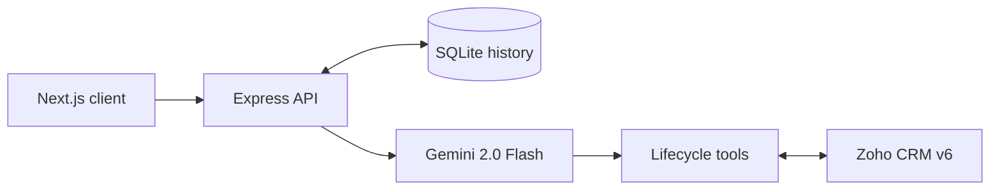

# Aster — Multistage Automotive OEM AI Chat Agent

An enterprise-oriented automotive concierge for the full customer lifecycle. Aster runs a Next.js 14 chat experience over a Node.js/Express API, persists sessions in SQLite, uses Gemini 2.0 Flash function calling, and connects to Zoho CRM v6 through refresh-token OAuth.

## Lifecycle coverage

- **Lead:** identify a customer, qualify interest, and capture a lead in Zoho `Leads`.
- **Sales:** search the approved vehicle catalogue and arrange a test drive as a Zoho `Event` after explicit consent.
- **Ownership:** look up a delivery or order state through Zoho `Deals` using COQL.
- **After-sales:** record an issue and create a Zoho `Case` after explicit consent.

The agent will not write a lead, appointment, or case until a user has clearly confirmed the action. Account-specific lookup requires a supplied phone number. Chat history and tool audit details are stored locally.

## Architecture

See [architecture.mermaid](architecture.mermaid). The flow is:



## Quick start

Prerequisites: Node.js 20 or newer, a Google AI Studio Gemini API key, and (for live CRM writes) a Zoho OAuth client with an offline refresh token and CRM scopes.

```powershell
Copy-Item server/.env.example server/.env
Copy-Item client/.env.local.example client/.env.local
npm install
npm run seed
npm run dev
```

Open `http://localhost:3000`. The API starts at `http://localhost:4000`; `GET /health` confirms it is ready.

Set `GEMINI_API_KEY` in `server/.env` before chatting. The seeded record is `Ria Sharma`, phone `+919876543210`, which is useful for a local lookup demo. The browser creates normal UUID sessions; the seed is an API/database test fixture.

## Zoho configuration

Keep `ZOHO_ENABLED=false` for a safe local demo. To use your CRM, set all of the following in `server/.env`:

```dotenv
ZOHO_ENABLED=true
ZOHO_CLIENT_ID=1000.xxxxx
ZOHO_CLIENT_SECRET=xxxxx
ZOHO_REFRESH_TOKEN=1000.xxxxx
ZOHO_DC=in
```

`ZOHO_DC` is the Zoho data-centre suffix (`com`, `eu`, `in`, `com.au`, `jp`, or `ca`). The OAuth client refreshes access tokens in memory before Zoho v6 calls. Ensure the integration user has permissions for Leads, Events, Deals, and Cases. Your Zoho tenant may use custom module or field API names; update `server/src/crm/zohoClient.ts` to map those names before enabling production traffic.

## API contract

### `POST /api/chat`

```json
{
  "sessionId": "optional UUID",
  "message": "I want to test drive the XUV700",
  "customer": { "name": "Ria Sharma", "phone": "+919876543210" }
}
```

Returns the stable `sessionId`, assistant `reply`, current lifecycle `stage`, and an audit-friendly list of invoked tools. The API validates input size and shape. Send the returned ID on future requests to continue the conversation.

### `GET /api/history?sessionId=<UUID>`

Returns the session metadata and chronological messages, including persisted function-result audit details.

## Data model

SQLite uses the requested `sessions` and `messages` tables. It enables foreign keys and WAL journaling, and writes its database by default to `server/data/oem-agent.db`. Do not commit that directory.

## Production notes

- Put the API behind TLS and an authenticated application gateway; the example client intentionally keeps authentication out of scope.
- Restrict `CLIENT_ORIGIN` to your deployed client URL.
- Put Zoho credentials in a secret manager, rotate refresh tokens, and encrypt database volumes/backups.
- Add rate limiting, structured logging with PII redaction, error monitoring, and a user identity/OTP flow before exposing customer CRM data publicly.
- Review the real Zoho module/field configuration and add integration tests against a Zoho sandbox before production rollout.
