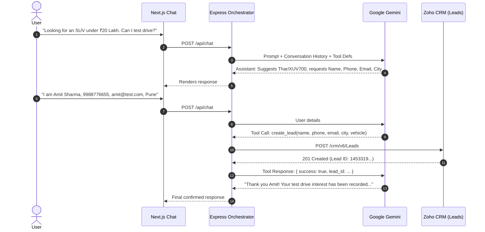
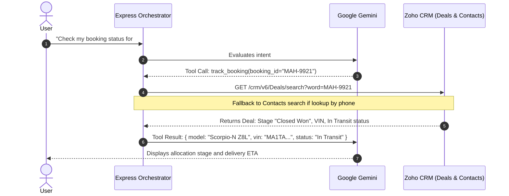
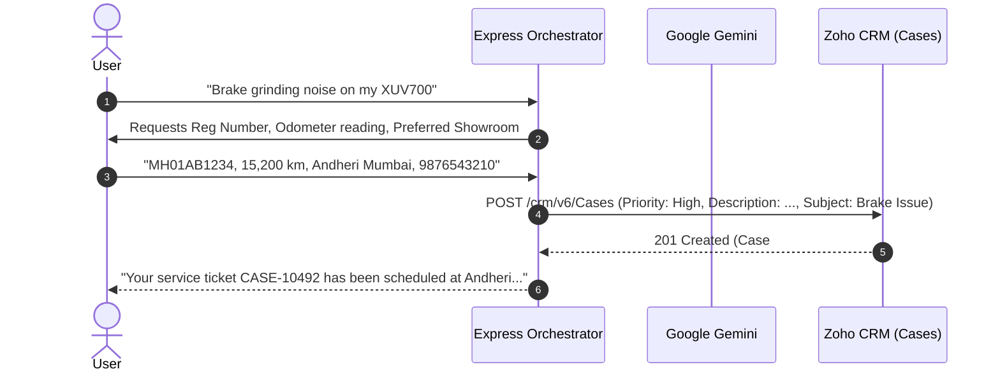

```markdown
# Aster OEM Concierge — Multistage Automotive Conversational AI Agent

> An enterprise-grade, conversational AI concierge tailored for automotive OEMs (e.g., Mahindra & Mahindra), featuring dynamic customer lifecycle intent recognition, bidirectional synchronization with Zoho CRM, and sub-second agentic tool calling.

---

## 📌 Executive Summary

**Aster OEM Concierge** guides prospective buyers and existing vehicle owners across the four critical stages of the automotive purchase and ownership lifecycle:
1. **New Lead Discovery:** Recommends models (XUV700, Thar, Scorpio-N), answers variant specs/pricing, pitches test drives, and captures qualified leads into Zoho CRM.
2. **Ongoing Pipeline Inquiry:** Authenticates existing prospects by phone/deal ID to retrieve scheduled test drive slots, quotation details, and showroom assignments.
3. **Booked Vehicle Tracking:** Identifies closed-won bookings via Booking ID (e.g., `MAH-9921`) to provide real-time VIN allocation and plant dispatch status.
4. **Post-Purchase Service Support:** Gathers vehicle registration, odometer reading, issue diagnostics, and logs prioritized service tickets directly into the Zoho CRM Cases module.

---

## 🛠 System Architecture & Tech Stack

| Layer | Technology | Purpose |
| :--- | :--- | :--- |
| **Frontend** | Next.js (App Router), React, Tailwind CSS, Lucide Icons | Responsive OEM chat UI, lifecycle badges, quick-action chips |
| **Backend** | Node.js, Express, TypeScript | Agent orchestration, Zoho CRM REST client, session memory |
| **AI / LLM** | Google Gemini (Function / Tool Calling) | Intent extraction, tool routing, conversational response generation |
| **CRM Integration** | Zoho CRM REST API v6 (OAuth 2.0) | Leads, Deals/Potentials, Contacts, Cases synchronization |
| **Persistence** | SQLite (`better-sqlite3`) | Fast, local multi-turn conversational history and state retention |
| **Infrastructure** | Docker, Docker Compose, NGINX Reverse Proxy, GCP Compute Engine | Production containerization and cloud hosting |
| **CI / CD** | GitHub Actions | Automated build, test, and continuous deployment over SSH |

---

## 🔄 Customer Lifecycle Matrix

| Lifecycle Stage | User Intent & Trigger | Agent Logic & Execution | Zoho CRM Module & Workflow |
| :--- | :--- | :--- | :--- |
| **1. New Lead** | Inquiry on specs, pricing, or recommendations (e.g., Thar vs. XUV700). | Recommends vehicle, pitches test drive, captures Full Name, Phone, Email, City. | Creates new record in **Leads** with custom vehicle interest field. |
| **2. Ongoing Pipeline** | Checking existing test drive schedule or quote using phone number. | Executes multi-vector lookup (word search & contact mapping) across Deals. | Searches and returns active deal in **Deals / Potentials** module. |
| **3. Booked Vehicle** | Asking for VIN allocation or delivery timeline with Booking ID (`MAH-9921`). | Validates booking ID and retrieves dispatch and allocation details. | Queries Deals with stage marked as **Closed Won - Booking Done**. |
| **4. Post-Purchase Service** | Reporting mechanical grievance (e.g., brake noise, periodic service). | Collects Vehicle Reg No, Odometer reading, service center, and issue summary. | Creates ticket in **Cases** module linked to existing customer contact. |

---

## 🚀 Quickstart & Local Installation

### Prerequisites
- Node.js 20+
- Docker & Docker Compose
- Zoho CRM Developer Account (Self-Client application registered)
- Google Gemini API Key

### 1. Clone the Repository
```bash
git clone [https://github.com/](https://github.com/)murli-pillamari/automatic-oem-ai-chat-agent.git
cd automatic-oem-ai-chat-agent

```

### 2. Environment Variables Setup

Create `.env` files in both `server/` and `client/` directories:

```bash
# In server/
cp server/.env.example server/.env

# In client/
cp client/.env.example client/.env

```

*(Populate your Zoho Client ID, Client Secret, Refresh Token, and Gemini API Key as shown in the Environment Configuration section below).*

### 3. Run with Docker Compose (Recommended)

```bash
docker compose up -d --build

```

The application will be live at:

* Frontend: `http://localhost:3000`
* Backend API: `http://localhost:5000`

### 4. Run Locally (Without Docker)

```bash
# Terminal 1 - Backend
cd server
npm install
npm run dev

# Terminal 2 - Frontend
cd client
npm install
npm run dev

```

---

## ⚙️ Environment Variables Reference

### `server/.env`

```env
PORT=5000
NODE_ENV=production

# Google Gemini API
GEMINI_API_KEY=AIzaSy...
GEMINI_MODEL=gemini-1.5-flash

# Zoho CRM OAuth 2.0 Credentials
ZOHO_CLIENT_ID=1000.XXXXXXXXXXXX
ZOHO_CLIENT_SECRET=xxxxxxxxxxxxxxxxxxxxxxxxxxxxxxxx
ZOHO_REFRESH_TOKEN=1000.xxxxxxxxxxxxxxxxxxxxxxxxxxxxxxxx.xxxxxxxxxxxxxxxxxxxxxxxxxxxxxxxx
ZOHO_ACCOUNTS_DOMAIN=[https://accounts.zoho.in](https://accounts.zoho.in)
ZOHO_API_DOMAIN=[https://www.zohoapis.in](https://www.zohoapis.in)

# SQLite Database
SQLITE_DB_PATH=./data/crm_agent.db

```

### `client/.env`

```env
NEXT_PUBLIC_API_URL=/api

```

---

## 🚢 Production Deployment (GCP Compute Engine)

This project is deployed to a Google Cloud Platform Compute Engine VM running Debian/Ubuntu Linux with NGINX reverse-proxying traffic to Docker containers:

* **NGINX Configuration:** Terminates incoming port 80 traffic, routes `/api/` to `http://127.0.0.1:5000/`, and `/` to Next.js on `http://127.0.0.1:3000/`.
* **Continuous Integration / Continuous Deployment:** Every push to `main` activates `.github/workflows/deploy.yml`, which triggers an automated remote build and container recreation.

---

## 📂 Project Structure

```
├── .github/
│   └── workflows/
│       └── deploy.yml          # GitHub Actions automated deployment pipeline
├── client/                     # Next.js Frontend Application
│   ├── src/
│   │   ├── app/                # App Router pages and layout
│   │   ├── components/         # Chat window, quick chips, message bubbles
│   │   └── lib/                # API client helpers
│   ├── Dockerfile
│   └── package.json
├── server/                     # Node.js/Express Backend & Agent Orchestrator
│   ├── src/
│   │   ├── agent/              # Gemini function calling tools & system prompts
│   │   ├── crm/                # Zoho CRM REST API client & OAuth token refresher
│   │   ├── db/                 # SQLite connection & session persistence
│   │   └── routes/             # Express API routes (/api/chat, /api/health)
│   ├── Dockerfile
│   └── package.json
├── docker-compose.yml          # Multi-container orchestration
├── ARCHITECTURE.md             # Detailed system flow and architecture diagrams
└── README.md

```

```

---

# 2. `ARCHITECTURE.md`

```markdown
# System Architecture & Technical Specification

## 1. High-Level System Workflow

The following architecture diagram outlines how incoming user prompts are classified, routed through Google Gemini function calling, matched against database state, and synchronized with Zoho CRM.


```

```
   +-------------------------------------------------------------+
   |                        User Browser                         |
   |                (Next.js Responsive Chat UI)                 |
   +------------------------------+------------------------------+
                                  |
                        HTTP POST /api/chat
                                  |
                                  v
   +-------------------------------------------------------------+
   |                     NGINX Reverse Proxy                     |
   |                 Port 80 (GCP Compute Engine)                |
   +--------------+-------------------------------+--------------+
                  |                               |
         /api/*   |                               |  /*
                  v                               v
   +-----------------------------+ +-----------------------------+
   |     Express Backend API     | |     Next.js Web Server      |
   |     (Container: Port 5000)  | |     (Container: Port 3000)  |
   +--------------+--------------+ +-----------------------------+
                  |
                  | 1. Load Session History
                  v
   +-----------------------------+
   |   SQLite Session Storage    |
   |     (`crm_agent.db`)        |
   +--------------+--------------+
                  |
                  | 2. Prompt + Tools Payload
                  v
   +-----------------------------+
   |      Google Gemini API      |
   |      (Intent & Routing)     |
   +--------------+--------------+
                  |
                  | 3. Structured Function Calling
                  |    (create_lead, check_deal_status,
                  |     track_booking, create_service_ticket)
                  v
   +-----------------------------+
   |    Zoho CRM OAuth Client    |
   | (Token Cache & Auto-Refresh)|
   +--------------+--------------+
                  |
                  | 4. REST v6 Endpoints (HTTPS)
                  v
   +-------------------------------------------------------------+
   |                          Zoho CRM                           |
   |    +------------+  +-------------+  +------------------+    |
   |    |   Leads    |  |    Deals    |  |  Cases / Tickets |    |
   |    |  (Stage 1) |  | (Stages 2&3)|  |    (Stage 4)     |    |
   |    +------------+  +-------------+  +------------------+    |
   +-------------------------------------------------------------+

```

```

---

## 2. Sequence Diagram: Multi-Turn Lifecycle Interaction

### Stage 1: New Lead Capture


### Stage 2 & 3: Ongoing Pipeline & Booked Vehicle Lookup



### Stage 4: Post-Purchase Service Ticket



---

## 3. Resilience, Error Handling & Token Management

1. **OAuth 2.0 In-Memory Refreshing:** Access tokens are stored in an in-memory cache with an expiration safety buffer (300 seconds). When expired, the refresh token automatically provisions a new access token without terminating customer chat sessions.
2. **Zoho Deals Phone Search Resilience:** Because the Zoho CRM Deals module does not feature a standard `phone` indexed field, the backend implements a resilient multi-tier fallback:
* Global `word` query matching phone numbers in Deal Names and Descriptions.
* Secondary lookup through `/crm/v6/Contacts/search?phone=...`, retrieving the Contact ID and querying linked Deals.


3. **Database Concurrency:** SQLite session tables use write-ahead logging (WAL) mode to support concurrent multi-turn chat sessions without table lockouts.

```

---

# 3. Environment Example Files

### `server/.env.example`
```env
# Server Configuration
PORT=5000
NODE_ENV=production

# Google Gemini API
GEMINI_API_KEY=your_gemini_api_key_here
GEMINI_MODEL=gemini-1.5-flash

# Zoho CRM OAuth 2.0 Configuration
# Generated from Zoho Developer Console (Self-Client)
ZOHO_CLIENT_ID=your_zoho_client_id
ZOHO_CLIENT_SECRET=your_zoho_client_secret
ZOHO_REFRESH_TOKEN=your_zoho_refresh_token
ZOHO_ACCOUNTS_DOMAIN=https://accounts.zoho.in
ZOHO_API_DOMAIN=https://www.zohoapis.in

# SQLite Database Path
SQLITE_DB_PATH=./data/crm_agent.db

```

### `client/.env.example`

```env
# Next.js Public API Base URL
# In production behind NGINX, use '/api'. In local development, use 'http://localhost:5000/api'
NEXT_PUBLIC_API_URL=/api

```

---

## 4. Final Submission Checklist

Before submitting the private GitHub repository link and Loom URL:

* [x] **`README.md`** added to the repository root with setup steps and commands.
* [x] **`ARCHITECTURE.md`** added with system diagrams and lifecycle workflows.
* [x] **`.env.example`** placed in both `server/` and `client/` directories.
* [x] Sensitive credentials (`.env`, `crm_agent.db`, private keys) confirmed absent from Git history via `.gitignore`.
* [x] Live cloud deployment verified accessible at `[http://35.200.167.220/](http://35.200.167.220/)`.


* [x] 5–7 minute Loom demo video recorded showcasing all 4 stages synchronized with Zoho CRM in real time.